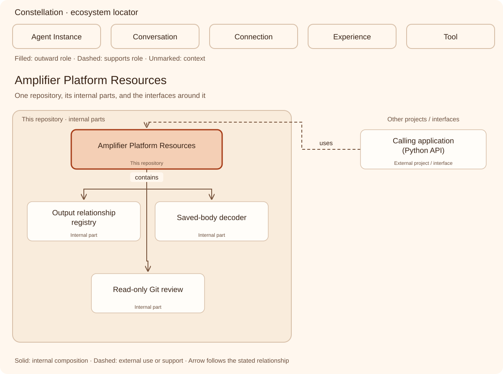

# Output relationships and Git evidence

`amplifier_outputs` stores output relationships in a caller-supplied SQLite
connection, decodes historical saved-body representations, and captures bounded
read-only Git review evidence. It uses Python's standard library; it does not
need Unified, Core, Foundation, a provider or a web client.

The caller owns transactions, authorization, source access, content storage,
integrity checks and serialization. The registry owns relationship revisions,
lineage, command receipts and local comments. Unlinking changes a relationship;
it does not delete the underlying work or its retained body. Git snapshots do
not apply changes or post comments. They disable conversion filters and external
diffs, exclude untracked files and binary contents, and retain exact displayed
hunk anchors. They are bounded evidence, not transactional repository snapshots.

`amplifier_outputs.content` preserves the `canvas-json-v1`, `canvas-image-v1`
and older encoded-body representations. Decoding a body is not authorization
to read it or proof that it matches its recorded hash; those checks remain with
the caller. The existing imports and stored formats are unchanged.

## Ecosystem map

[Project overview](https://microsoft.github.io/amplifier-constellation/projects/amplifier-platform-resources/) ·
[Open the map](https://github.com/bkrabach/amplifier-platform-resources/blob/main/docs/ecosystem-map.svg) ·
[Map guide](https://github.com/microsoft/amplifier-constellation/blob/main/docs/ecosystem-maps.md)



<details>
<summary>The wider Constellation ecosystem</summary>


</details>

These maps are generated from the [canonical registry](https://github.com/microsoft/amplifier-constellation/blob/main/docs/ecosystem/registry.json).
Update that source and refresh the local maps together; a map is not a release or compatibility claim.

## Develop and qualify

Use Python 3.13 or newer with SQLite JSON functions, Git on `PATH`, and `uv`.
From this directory, run the existing real-Git and SQLite mechanism tests with:

```sh
uv run --extra test pytest
```

`uv build` produces a wheel and source distribution. For an installed-artifact
check, create a separate environment, install the local wheel with its `test`
extra, and copy `tests/` plus `pyproject.toml` to a directory outside this source
tree. Run that environment's `python -I -m pytest` there. Confirm imports resolve
inside the environment and that Unified/Core/Foundation are absent. The source
distribution includes the same tests. The Git fixtures use a POSIX shell; Linux
qualification alone does not establish Windows or macOS behavior.

The version alone does not identify published or qualified bytes; use the actual
release receipt and artifact hashes. Unified builds the explicitly selected public
artifact into its own distribution; author changes do not refresh that selection.
**Do not coinstall `amplifier-outputs` in a Unified environment**: both distributions
would claim the same import package. Repository delivery and the broader
resource-lifecycle boundary remain separate decisions.

In the Unified checkout, [the output guide](https://github.com/microsoft/amplifier-unified/blob/559d388ae4cefbedc048b8af54c72b94216b4e18/docs/OUTPUTS.md) describes host
actions, resource retention, authorization and integration behavior. Its host
tests remain with Unified; the standalone tests do not establish those promises.

## Ownership and provenance

This history-preserving project is prepared as the public author home at
`bkrabach/amplifier-platform-resources`, with a later transfer to Microsoft planned.
[PROVENANCE.json](PROVENANCE.json) records the original public Unified source,
pre-move history, and exact imported runtime/test bytes. Original MIT attribution
is preserved. The repository name does not rename the `amplifier-outputs`
distribution or `amplifier_outputs` import.

This import changes no runtime behavior, dependency requirement, package version,
or maintained test. Unified retains its host integration and policy. Authoring
handoff and consumer selection are separate reviewed changes; retire Unified’s
authored project at handoff rather than maintain two authoring copies.

This is the existing Python outputs mechanism, not the whole resources domain.
It does not replace the separate JavaScript
`microsoft/amplifier-unified-capability-resources` authoritative store.

Use a separate environment for this distribution. Do not coinstall it with
`amplifier-unified`, which currently owns its selected `amplifier_outputs` files.
This source import is not independent pip replacement inside a Unified prefix.

## Independent artifact publication

Unified continues to select the immutable [outputs-v0.1.0 artifacts](https://github.com/microsoft/amplifier-unified/releases/tag/outputs-v0.1.0)
from their original public producer. The original source receipt, revision,
subdirectory and hashes remain historical identities; this repository does not
republish or relabel those artifacts. Unified’s generated `components/outputs-delivery/`
is selected by `components/outputs.source.json` and verified offline during
normal builds. Do not edit that generated copy by hand.

The [package workflow](.github/workflows/package.yml) builds and verifies one wheel
and source archive from an exact selected commit, then tests the installed wheel
outside the checkout. Its Linux/Python 3.13 check retains the existing async Git
and SQLite cases; the pytest-asyncio plugin is loaded explicitly. Publication is
separate from source acceptance and Unified selection.

After review and merge, the release owner can dispatch `package.yml` from `main`
with the full merged revision and `publish=true`. The workflow publishes only
`amplifier_outputs-X.Y.Z-py3-none-any.whl`, `amplifier_outputs-X.Y.Z.tar.gz`,
`outputs-source.json`, and `SHA256SUMS` under `outputs-vX.Y.Z`. Pull requests and
ordinary pushes do not publish. Version 0.1.0, the `amplifier-outputs` distribution
and `amplifier_outputs` imports are unchanged by this producer setup.

The receipt declares component `outputs`, repository
`bkrabach/amplifier-platform-resources`, root subdirectory `.`, full source revision
and tree, exact package inputs, and original artifact hashes. The wheel contains
only the existing runtime and its metadata/license. The source archive also
preserves tests, documentation and provenance; release automation is bound by the
root tree without becoming another installed package.

Tags and assets are immutable. Retain the original four build assets after a
failed or cancelled publication response, inspect their saved remote state, then
explicitly rerun only the publication job. The producer reconciles the same tag,
release ID and bytes; it never overwrites mismatches or automatically retries an
uncertain mutation. A completed retry only verifies the original release.

Download all four assets into an owned directory and verify `SHA256SUMS` and the
source receipt before standalone installation. For local artifact qualification,
use the source-bound helper (substitute exact paths and the full source revision):

```sh
python scripts/release.py seal --revision FULL_SOURCE_SHA --dist /path/to/dist --qualification
python scripts/release.py verify --revision FULL_SOURCE_SHA --dist /path/to/dist --qualification
```

The qualification flag permits an unmerged build; it cannot publish. Unified must
explicitly select and qualify the new root-layout receipt before retiring its
author copy and shipping these public artifacts. Prior Microsoft receipts, app
rollback and newer user state retain their original meaning. This delivery change
adds no resource-store, media, retention or authorization policy.

## Project guidance

The original MIT license and Microsoft open-source conduct, security and support
guidance are retained for this eventual Microsoft home. This repository is
currently hosted under `bkrabach`; it does not claim Microsoft organization
automation, CLA enforcement, release service connections or support coverage.
The existing security-reporting guidance is retained; do not post vulnerabilities
in public issues.
